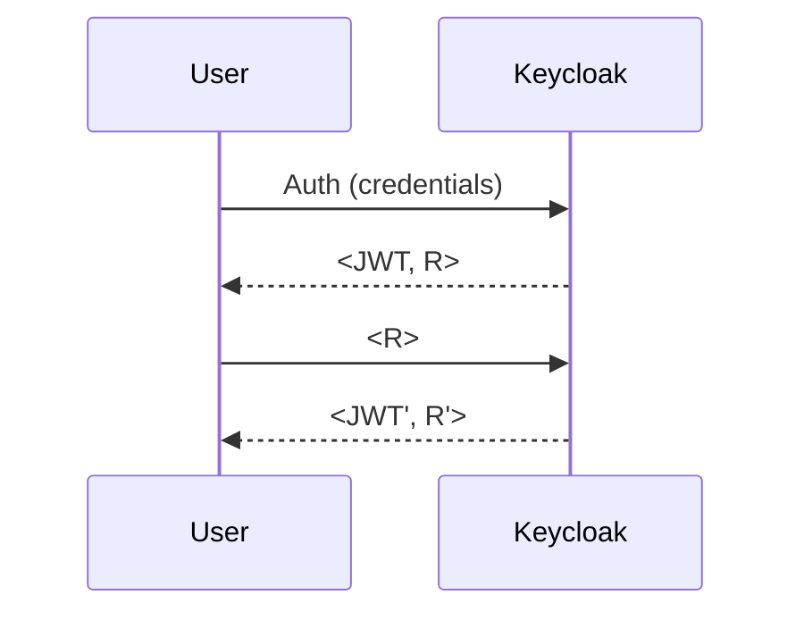

# Operational flows

This page details the main runtime workflows between the components of the
Archiviart system: the frontend apps, `archiviart-core`, **Keycloak** and
`archiviart-fs`.

## 1. Authentication and session management

Handles user login and the secure token lifecycle.

- **Initial authentication (login)**
    - The user authenticates through the frontend, which talks directly to
      **Keycloak** using the OIDC protocol.
    - Keycloak validates the credentials and returns both the **JWT Bearer
      token** and the **refresh token** to the client.
- **Token verification**
    - For protected requests, the frontend sends the JWT Bearer token to
      `archiviart-core`.
    - The backend validates the token signature against Keycloak's remote JSON
      Web Key Sets (**JWKS**) using `go-oidc`.

### Refresh token

The refresh token keeps the session active without asking for the credentials
again.

1. First login (user → Keycloak).
2. The response contains both the JWT and the refresh token (Keycloak → user).
3. The client stores the refresh token.
4. When the JWT expires, the client sends a `POST` with only the refresh token
   (user → Keycloak).
5. Keycloak verifies it and responds with a new `<JWT, refresh token>` pair
   (Keycloak → user).

!!! tip "Testing without the frontend"
    `get-token.rest` and `get-refresh-token.rest` (VS Code REST Client files in
    `archiviart-core`) call the Keycloak OIDC token endpoint directly, with no
    backend involvement. They send `client_id`, `client_secret`,
    `grant_type=password` and the user credentials, and read the refresh token
    straight from Keycloak's response.

## 2. File upload (ingestion and storage)

Upload, processing and persistence of a new document.

- **Ingestion**: the user uploads a file through the web interface. The
  frontend sends an HTTP request with the file stream and the Bearer token to
  `archiviart-core`.
- **Authorization**: the backend intercepts the request and verifies the JWT.
- **Storage delegation**: on success, the backend forwards the file stream to
  the **SeaweedFS filer** (`archiviart-fs`).
- **Internal storage processing**
    - **Binary persistence**: the filer splits the file into chunks and stores
      them on the **volume servers**.
    - **Filer index**: the filer records the folder structure, path, file name
      and chunk references in its own metadata store.
- **Application metadata**: the backend stores the file metadata in
  PostgreSQL (`archiviart_main_db`) and queues an OCR event, processed
  asynchronously by `ocrserver`.

!!! note
    PostgreSQL stores only metadata, never the binary files.

## 3. File download and retrieval

How a file is fetched for viewing, editing or processing (e.g. OCR).

- **Retrieval request**: the frontend requests a file from `archiviart-core`,
  passing the authentication token and the file path or id.
- **Querying the storage layer**: the backend requests the file stream from the
  **SeaweedFS filer**, which resolves the path, structure and chunk locations.
- **Recomposition and delivery**: the filer retrieves the binary chunks from
  the volume servers, rebuilds the file stream and returns it to the backend,
  which forwards it to the client.
