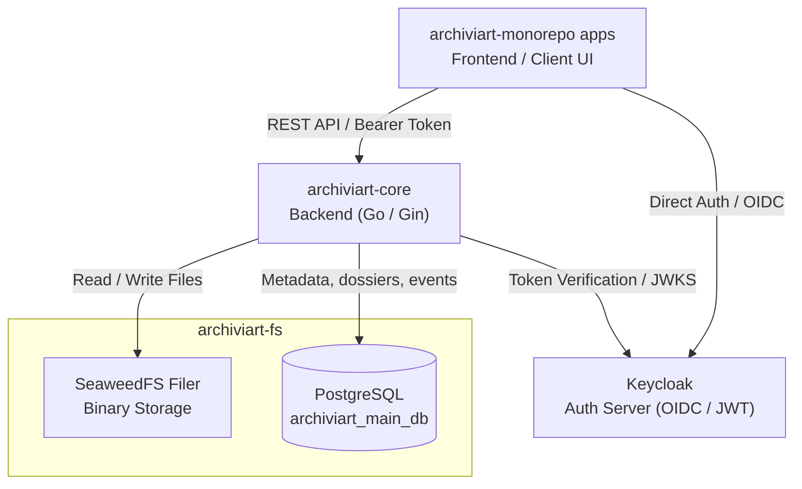

# Architecture overview

Archiviart adopts a modular, component-based architecture that separates the
storage infrastructure, the core business logic, security and the client user
interface:

- **archiviart-fs**: storage infrastructure layer
- **archiviart-core**: backend business logic and API layer
- **archiviart-monorepo**: frontend and client layer
- **Keycloak**: authentication server (OIDC)

## archiviart-fs (storage layer)

`archiviart-fs` is the infrastructure module responsible for the physical and
persistent storage of files (documents, PDFs and attachments). Instead of
overloading the application database with binary payloads, Archiviart delegates
file storage to a distributed, containerized file system powered by
[SeaweedFS](https://github.com/seaweedfs/seaweedfs).

- **Docker Compose** manages the whole topology in isolated containers: master,
  volume server, filer (with volume data encryption) and S3 gateway
  (`config/s3.json`).
- **Persistent volumes**: volume data is mapped to `volumes/` for persistent
  retention.
- **Main database**: the same compose file runs PostgreSQL 16
  (`archiviart_main_db`), used by `archiviart-core` for file metadata,
  dossiers, user metadata and events. See the [ER diagram](../database/er-diagram.md).

## archiviart-core (backend layer)

`archiviart-core` is the central application and business logic engine, written
in Go. It exposes REST APIs (`/api/v1`) for upload, metadata handling, document
search and orchestration, and acts as an OIDC resource server.

- **Web framework**: [Gin](https://gin-gonic.com/) handles HTTP routing and
  request processing. The API contract is documented with Swagger.
- **Security and authentication (Keycloak OIDC)**:
    - tokens are issued directly by Keycloak;
    - the backend validates JWTs cryptographically against Keycloak's remote
      JSON Web Key Sets (JWKS) via `go-oidc`;
    - the middleware (`claims.go`, `verifier.go`, `auth.go`) protects every
      path except a whitelist of public routes (Swagger, health check, public
      auth endpoints).
- **Storage**: files are stored in SeaweedFS under
  `<hashed user id>/<file name>` (user ids hashed with Keccak256); metadata is
  stored in PostgreSQL.
- **Asynchronous OCR**: uploads create events (`PENDING → PROCESSING →
  COMPLETED / FAILED`). The `ocrserver` worker polls them in batches and runs
  `script/tesseract.sh`, which fetches the file from `archiviart-fs` and
  extracts the text with Tesseract (Italian + English).

## Frontend layer

The frontend apps (in `archiviart-monorepo`) provide the user interface: users
authenticate, upload documents, manage their metadata and browse the document
archive through the core API endpoints. Authentication uses next-auth with the
Keycloak provider; every API call carries the user's Bearer token.
