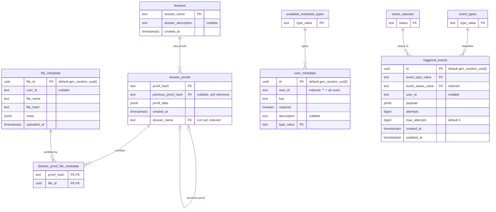

# archiviart-core — ER Diagram

Entity-Relationship diagram of the PostgreSQL schema created by the
`archiviart-core` migration (`modules/service/cmd/main.go`, GORM `AutoMigrate`
on the models in `modules/service/data/dbmodel.go`).

Column names follow GORM's default snake_case naming; types are the ones GORM
generates on PostgreSQL.

## Notes

- **Append-only tables**: `dossiers`, `dossier_proofs` and
  `dossier_proof_file_metadata` have a `<table>_append_only` trigger that calls
  `prevent_mutation()` and rejects `UPDATE`, `DELETE` and `TRUNCATE`.
- **Proof chain**: each `dossier_proofs` row points to the previous proof via
  `previous_proof_hash` (`NULL` for the first proof of the chain).
- **Proof ↔ file**: many-to-many through `dossier_proof_file_metadata`.
- **Lookup tables seeded by the migration**:
    - `available_metadata_types`: `TEXT`, `NUMBER`, `BOOLEAN`, `DATE`, `TIME`
    - `event_statuses`: `PENDING`, `PROCESSING`, `COMPLETED`, `FAILED`
    - `event_types`: `OCR`
    - `user_metadata`: one row `user_id = '*'`, `key = 'name'`, `required = true`, `type_value = 'TEXT'`
- **`user_id`** columns hold the Keycloak subject; there is no users table in
  the core database.
- **Not migrated yet** (commented out): `vendor_types`, `vendors`,
  `participants`, `items`, `showcases`, `file_raw_contents`.
